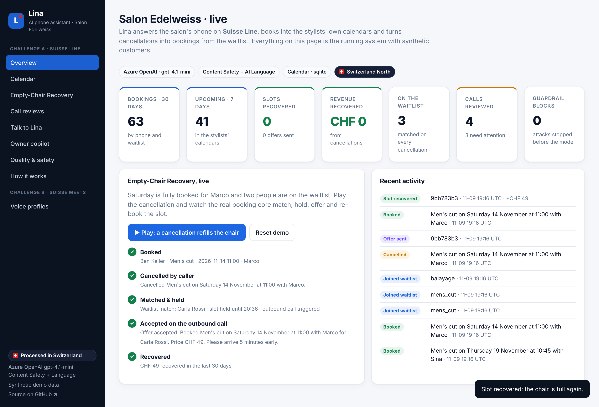

# Lina: AI phone assistant for a Swiss hair salon

**Lina answers the phone for Salon Edelweiss in Zürich.** She speaks Swiss German, German, French, Italian and English, and books, moves and cancels appointments directly in the stylists' calendars. Her extra feature: **when someone cancels, she offers the freed slot to the next person on the waitlist and calls them**, so a cancellation becomes a booking instead of an empty chair.

Built on **[Suisse Line](https://suisse-line.ch)** for *Challenge A* of the Suisse IT *AI Product Builder* application. Everything runs in Switzerland.

**Live demo:** <https://ca-lina-yrrwxlzlnd7w2.wittyisland-bad0e48d.switzerlandnorth.azurecontainerapps.io> (synthetic data, Azure Switzerland North)

**Start here:** [Executive summary](docs/executive-summary.md) · [Solution walkthrough](docs/solution-walkthrough.md) · [Architecture](docs/architecture/overview.md) · [Challenge B: voice profiles](docs/voice-profiles/concept.md)


## The challenge, answered

| Asked for | Answer |
| --- | --- |
| A trial account at suisse-line.ch | The agent runs **on Suisse Line**: prompt, voice, knowledge base and 9 live tools in [`suisse-line/`](suisse-line), [setup guide](docs/operations/setup-suisse-line.md) |
| A phone assistant for a small business that books appointments | A real salon model: 3 stylists, 8 services, durations, skills, working days, buffers. A deterministic booking core that cannot double-book ([why](docs/decisions/0002-deterministic-booking-core.md)) |
| Connect it to any calendar | **Google Calendar** and **Outlook / Microsoft 365**, one calendar per stylist, which stays the source of truth. The full booking and recovery flow is tested on both |
| One feature of my own | **Empty-Chair Recovery**: waitlist → exact match on cancellation → held offer → outbound call → cascade ([why this one](docs/product/brief.md#the-one-feature-empty-chair-recovery)) |
| Show how it was built | [Architecture](docs/architecture/overview.md), [8 decision records](docs/decisions/README.md), built with AI coding agents |
| Show how it was tested | [4 levels](docs/evaluation/strategy.md): 85 CI tests (incl. agents with a scripted model, guardrails proven by breaking them) → platform contract (Suisse Line limits, Bicep, container) → AI-driven conversation evaluation with attacker personas → real calls ([safety](docs/safety/guardrails.md)) |

The full mapping with status: **[product brief](docs/product/brief.md)**.

## See it work in one minute

```bash
python -m venv .venv && . .venv/bin/activate
pip install -r requirements-dev.txt
python scripts/simulate_call.py     # three calls: booking · recognised caller moves · full day → waitlist → cancellation → offer
pytest                              # 85 tests
PUBLIC_DEMO=1 DEMO_SEED=1 uvicorn app.main:create_app --factory --reload   # web app at http://localhost:8000
```

Without calendar credentials the backend uses a local SQLite calendar, so everything runs immediately.



## How it is built

* **Suisse Line is the voice.** Speech, dialect, phone number and outbound calls stay in the product the assistant runs on ([0001](docs/decisions/0001-suisse-line-is-the-voice-runtime.md)).
* **Deterministic code decides bookings; the model only talks.** Tools are designed for a voice model: enums, at most three options, a speakable `message`, `ok:false` instead of HTTP errors, idempotent, fail-closed ([architecture](docs/architecture/overview.md#tool-design-for-a-voice-model)).
* **One tool registry, three surfaces:** Suisse Line live tools, MCP servers (caller and owner scopes) and the generated `tools.json` all derive from [`app/tools.py`](app/tools.py) ([agents, tools and MCP](docs/architecture/agents-and-tools.md)).
* **Agents work around the call, not in it:** a call reviewer after every call, a prompt lab on a sandbox calendar, and a read-only owner copilot, on the OpenAI Agents SDK with Azure OpenAI (regional, Switzerland North). They use the MCP tools and Azure AI services as tools: Prompt Shields, harm detection, PII redaction, sentiment ([0005](docs/decisions/0005-ai-around-the-call-not-in-the-booking-path.md)).
* **Guardrails in five layers**, the strongest of which don't depend on a model ([safety](docs/safety/guardrails.md)).
* **Switzerland only:** Suisse Line plus Azure Switzerland North with regional model deployments. Agent traces stay local instead of the SDK's default export to OpenAI ([0004](docs/decisions/0004-switzerland-only-processing.md)).
* **Keyless launch:** Bicep + `azd`, GitHub Actions with OIDC, managed identity everywhere, secrets generated into Key Vault ([deploy guide](docs/operations/deploy-azure.md)).

## Repository

```
suisse-line/        agent config for the Suisse Line portal: prompt, greeting, knowledge base, tools, outbound agent
app/                booking core (FastAPI): slots, booking, Empty-Chair Recovery, HTTP + webhooks
  tools.py          the tool registry (→ live tools, MCP, tools.json)
  mcp_server.py     MCP servers: caller + owner scopes
  ai_tools.py       Azure AI Content Safety + Language as tools, with offline rules
  ai_agents/        prompt lab, call reviewer, owner copilot, guardrails, local tracing
  calendars/        Google, Outlook / Microsoft 365, SQLite
infra/              Bicep (Switzerland North), Cloud Shell bootstrap for keyless GitHub deployment
data/salon.json     the business: services, prices, stylists, opening hours (a new business = a new file)
tests/              85 tests + conversation scenarios for the real voice agent
scripts/            call simulator · voice-agent evaluation · export_tools · verify_deployment · connect_outlook · diagram as code
docs/               product · architecture · decisions · safety · evaluation · operations · voice profiles
```

## Status

| Done | In progress |
| --- | --- |
| Suisse Line agent configuration · booking core · Empty-Chair Recovery · Google and Outlook calendars · tool registry · MCP servers · Azure AI tools · agents (prompt lab, call reviewer, owner copilot) with guardrails and local tracing · web cockpit and public demo · keyless deployment to Azure Switzerland North · 85 tests in CI | live phone number on a Suisse Line trial with real-call results · evaluation lab with AI caller personas · Outlook connected in the live deployment |

---
*Bonus, Challenge B: a concept for voice profiles in Suisse Meets, including how it plugs into the Suisse Meets API → [docs/voice-profiles](docs/voice-profiles/concept.md).*
