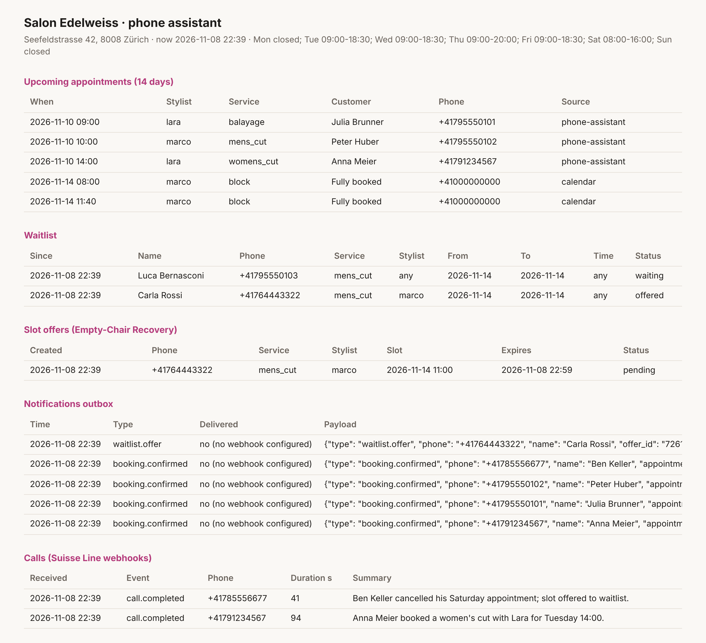
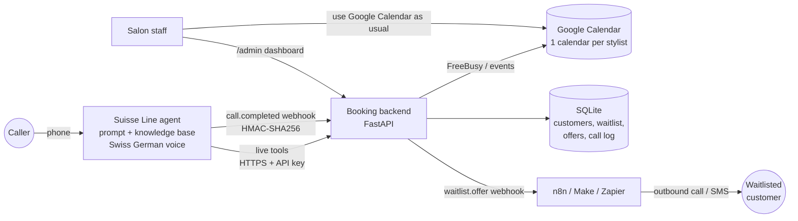

# Salon Phone Assistant: AI receptionist on Suisse Line

An AI phone assistant for a small hair salon (**Salon Edelweiss, Zürich**). It answers calls in Swiss German, French, Italian and English and **books, moves and cancels appointments directly in Google Calendar**. It also includes one feature of my own, **Empty-Chair Recovery**: when a client cancels, the freed slot is offered to people on the waitlist automatically.

> Built for **Challenge A** of the Suisse IT *AI Product Builder* application:
> a Suisse Line phone assistant for a small business that answers calls and books appointments, connected to a calendar, plus one feature of my own.
> The voice agent runs on **Suisse Line**. This repo contains its configuration and the booking backend it calls during the conversation.

---

## What a caller can do

| Caller says | What happens |
| --- | --- |
| "Hetted Sie morn am zwei öppis für en Damehaarschnitt?" | Checks the stylists' real Google calendars and offers at most 3 times, the closest to 14:00 first |
| "Ja, buechet Sie das." | Re-checks the slot under a lock (no double booking) and creates the event in the stylist's calendar |
| "Grüezi, ich bi d Anna Meier…" | Recognises the number: *"Wieder en Schnitt bi de Lara?"*, plus her upcoming appointments |
| "Chan ich mis Termin verschiebe?" | Moves it. The old slot is released only after the new one is booked |
| "Ich muss absäge." | Cancels it, mentions the 24-hour policy if it is late, and offers the freed slot to the waitlist |
| "Samschtig isch alles voll? Schad." | **Puts the caller on the waitlist** (service, stylist, days, time of day) |
| Questions about prices, parking, payment | Answered from the knowledge base, never invented |

## My own feature: Empty-Chair Recovery

A salon's main costs are its chairs and its staff's time. A cancellation the day before usually means an **empty chair**, because the people who wanted that slot were turned away days earlier.

```
Saturday is full ──► caller joins waitlist (service, stylist, date range, time of day)
                         │
Someone cancels ──► freed time matched against waitlist ──► first fitting person gets an offer
                         │                                    (slot held for 20 min)
                         ├─ accepts  ──► booked in Google Calendar
                         ├─ declines ──► next person on the list
                         └─ no answer ─► offer expires ──► next person
```

* **Matching is exact.** The service must fit the freed time, the stylist must offer it, and date range, time of day and stylist preference all have to match. A 3-hour balayage is never offered a 30-minute gap.
* **Slot hold.** While an offer is open, nobody else is offered that slot. It cascades on decline or timeout and is never offered twice to the same person.
* **Delivery.** A signed `waitlist.offer` webhook goes to n8n, Make or Zapier, which starts a **Suisse Line outbound call** with the offer agent ([`suisse-line/outbound-offer-agent.md`](suisse-line/outbound-offer-agent.md)) or sends an SMS. If the customer calls back instead, the inbound assistant sees the pending offer and offers it first.

Run `python scripts/simulate_call.py waitlist` to watch the whole flow.



## Architecture



**Why a backend instead of only the built-in calendar connection?** Suisse Line can connect Google or Outlook itself, but a salon needs more than "add an event":

* every service has its own duration (a men's cut is 30 min, a balayage 3 h),
* each stylist offers only certain services and works on certain days,
* there must be a cleanup buffer between clients and a minimum lead time,
* the waitlist and slot offers need state.

The salon's Google Calendar remains the **single source of truth**. Staff keep using it normally, and anything they enter (lunch, holidays, walk-ins) blocks the slot through the FreeBusy API.

More detail: [`docs/design-notes.md`](docs/design-notes.md).

## Repository layout

```
suisse-line/                  ← everything that goes into the Suisse Line portal
  system-prompt.md              agent instructions (voice style, flows, rules)
  greeting.txt                  "Grüezi, Salon Edelweiss, da isch d Lina…"
  tools.json                    9 live tools (name, description, JSON schema, endpoint)
  knowledge-base/               salon facts, prices, policies (upload as document)
  outbound-offer-agent.md       2nd agent: calls waitlisted customers with an offer
app/                          ← booking backend (FastAPI)
  slots.py                      pure availability logic (opening hours, durations, buffers)
  booking.py                    tools + Empty-Chair Recovery
  calendars/                    Google Calendar adapter + local SQLite adapter
  main.py                       HTTP layer: /tools/*, /webhooks/suisse-line, /admin
data/salon.json               ← business config: services, prices, stylists, hours
tests/                        ← 39 automated tests + conversation scenarios
scripts/simulate_call.py      ← replays realistic calls (demo without a phone)
scripts/agent_eval.py         ← conversation tests against the real Suisse voice agent
docs/                         ← setup guides, test plan, design notes, Challenge B concept
```

Onboarding another business (barber, nail studio, physio) means editing `data/salon.json`, the prompt and the knowledge base. No code changes.

## Quick start

```bash
python -m venv .venv && . .venv/bin/activate
pip install -r requirements-dev.txt
pytest                                  # 39 tests
python scripts/simulate_call.py         # 3 example calls incl. waitlist → cancellation → offer
uvicorn app.main:create_app --factory --reload   # http://localhost:8000/admin
```

Without Google credentials the backend uses a local SQLite calendar, so everything can be tried immediately. Going live:

1. [`docs/google-calendar-setup.md`](docs/google-calendar-setup.md): service account plus one calendar per stylist (about 10 min)
2. Deploy the container (Dockerfile, or `render.yaml` for one click) with the variables from `.env.example`
3. [`docs/setup-suisse-line.md`](docs/setup-suisse-line.md): create the trial agent, paste prompt and knowledge base, add the live tools and webhook

## How it is tested

Testing happens on four levels. Details and the manual test matrix are in [`docs/test-plan.md`](docs/test-plan.md).

1. **Unit tests for availability** (`tests/test_slots.py`): opening hours, service durations, buffers, lead time, stylist days, daylight-saving days.
2. **Phone-call scenarios against the API** (`tests/test_tools_api.py`, `tests/test_waitlist.py`): booking, double-booking race, idempotent retries, rescheduling (including rollback), cancelling someone else's appointment, late cancellation, and the full waitlist → cancel → offer → accept / decline / expire cascade.
3. **Platform contract** (`tests/test_suisse_line_config.py`): the tool definitions are checked against the limits in the Suisse Speech API reference (allowed JSON-Schema keywords, name pattern, 1,024-character descriptions, 16k/24k prompt and tool budget, max 32 tools), and against the backend's real parameters and the salon's service/stylist IDs. Also covered: webhook HMAC (valid, tampered, missing, retried) and the Google adapter against a fake API client.
4. **Conversations with the real voice agent**: `scripts/agent_eval.py` runs scripted calls in Swiss German, French and English over the Suisse voice-agent WebSocket (text mode), answers the agent's tool calls from a fresh backend and asserts what was booked. It also includes adversarial cases (no booking without confirmation, refusing to cancel another person's appointment). Then real test calls to the Suisse Line number, following the matrix in the test plan.

> **Honest status.** Levels 1–3 run in CI and pass. Level 4 and the Google adapter against a *real* calendar need my trial account, a Suisse Speech API key with the voice agent enabled, and Google credentials. The scripts and checklists are ready; the results go into `docs/test-plan.md`.

## Security and data protection

* Live tools require an API key (`X-Api-Key` or Bearer). Webhooks are verified with HMAC-SHA256 over the raw body.
* Callers can only see, move or cancel appointments booked under their own number. Known limitation: the number is passed by the agent, see [`docs/design-notes.md`](docs/design-notes.md#known-limitations).
* Minimal data: name, phone number, service, time. No call recordings are stored in the backend.
* Runs in any Swiss-hosted container to keep Suisse Line's Swiss data residency end to end.

---

*Bonus: a concept for Challenge B (voice profiles for Suisse Meets) is in [`docs/challenge-b-voice-profiles.md`](docs/challenge-b-voice-profiles.md).*
