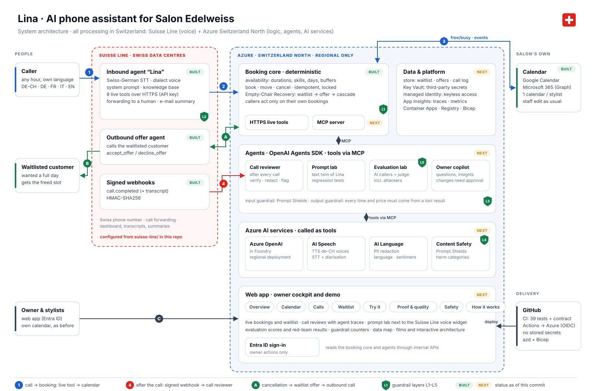

# Architecture

*Diagram as code: [`scripts/render_architecture.py`](../../scripts/render_architecture.py). BUILT / NEXT tags show the state of this commit.*

## Three zones, one rule

| Zone | Runs | Why there |
| --- | --- | --- |
| **Suisse Line** (Swiss data centres) | the live conversation: speech recognition, dialect voice, prompt, knowledge base, phone number, forwarding, outbound calls | it is the product the assistant is built on ([0001](../decisions/0001-suisse-line-is-the-voice-runtime.md)) |
| **Azure Switzerland North** | booking core, store, agents, AI services, web app | business logic and AI around the call, in the same country as the voice ([0004](../decisions/0004-switzerland-only-processing.md)) |
| **Salon's own systems** | calendar (Google or Microsoft 365) | staff keep their calendar; it stays the source of truth ([0002](../decisions/0002-deterministic-booking-core.md)) |

**The rule:** anything that decides a booking is deterministic and tested; models only talk, review and test.

## Flows

**① → ③ A call becomes a booking**
1. The caller speaks to *Lina* on Suisse Line. Lina calls `lookup_caller` silently to learn today's date and whether the caller is known.
2. Lina calls the live tools `check_availability` → `book_appointment` over HTTPS with an API key. The booking core computes free slots from service duration, stylist skills and days, buffers and lead time, then re-checks under a lock and writes the event.
3. The event lands in the stylist's calendar with the caller's number in private properties, so the booking can be found again later.

**④ After the call: review** *(next)*
A signed `call.completed` webhook arrives. The **call reviewer** agent redacts personal data (AI Language), checks for prompt attacks and abuse (Content Safety), and checks the assistant's claims against the calendar ("Lina said *booked*: is there an event?"). Problems are flagged on the dashboard.

**Ⓐ → Ⓑ A cancellation refills the chair**
A cancellation or move frees time. The booking core matches it against the waitlist, holds the slot and emits `waitlist.offer`. The Suisse Line **outbound agent** calls the customer, who accepts or declines through tools. On decline or timeout the slot cascades to the next match.

**Ⓒ Owner cockpit** *(next)*
The owner signs in with Entra ID and sees bookings, waitlist, call reviews with agent traces, evaluation results, and guardrail counters.

## Components

| Component | Responsibility | Code | Status |
| --- | --- | --- | --- |
| Suisse Line agent config | prompt, greeting, knowledge base, tool definitions, outbound agent | [`suisse-line/`](../../suisse-line) | built |
| Availability engine | pure functions: slots from hours, durations, buffers, lead time | [`app/slots.py`](../../app/slots.py) | built |
| Booking service | tools, idempotency, ownership checks, Empty-Chair Recovery | [`app/booking.py`](../../app/booking.py) | built |
| HTTP layer | `/tools/*` (always HTTP 200 + speakable message), HMAC webhook, admin | [`app/main.py`](../../app/main.py) | built |
| Calendar adapters | Google (FreeBusy + private properties), SQLite (local), Microsoft 365 | [`app/calendars/`](../../app/calendars) | Google + SQLite built · M365 next |
| MCP server | same tools for agents and MCP clients ([0003](../decisions/0003-one-tool-registry-http-and-mcp.md)) | `app/mcp_server.py` | next |
| Agents | call reviewer, prompt lab, evaluation lab, owner copilot ([0005](../decisions/0005-ai-around-the-call-not-in-the-booking-path.md)) | `agents/` | next |
| Web app | owner cockpit and demo | `web/` | next |
| Infrastructure | Bicep + azd, keyless GitHub OIDC ([0007](../decisions/0007-keyless-deployment.md)) | `infra/` | next |

## Tool design for a voice model

The tools are designed for a model that speaks to a caller, not for a frontend:
* **Flat parameters with enums** (service and stylist IDs), checked against `data/salon.json` by a contract test.
* **Every result carries `ok` and a short `message`** the model can paraphrase, so prompts stay short and behaviour consistent.
* **Expected problems return `ok: false` with HTTP 200** and a speakable reason. A 4xx only lets a voice agent say "something went wrong".
* **At most three options** per answer, because nobody remembers twelve times read aloud.
* **Idempotent booking**, because models sometimes repeat a tool call.
* **Fail closed:** if the calendar cannot be read, nothing is offered.

More detail and known limitations: [design notes](design-notes.md).
