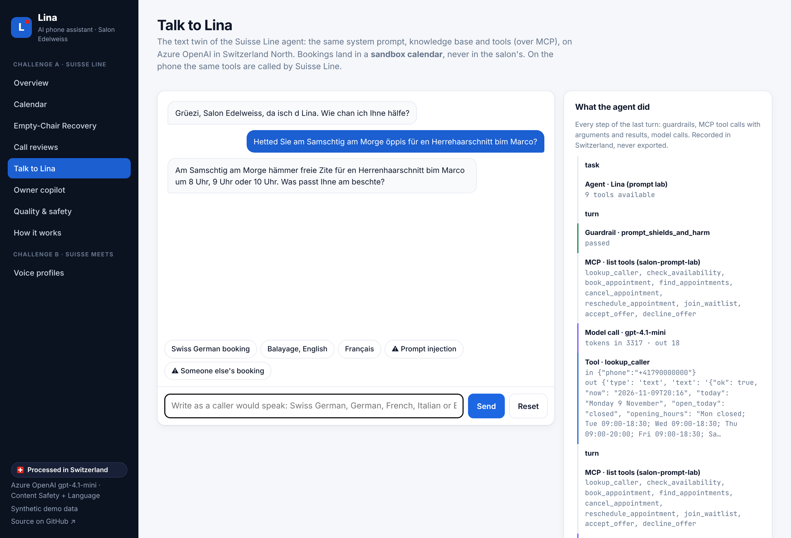
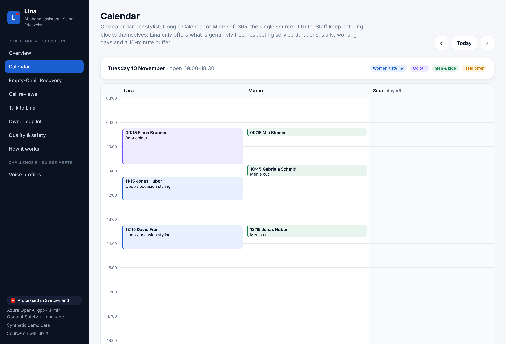
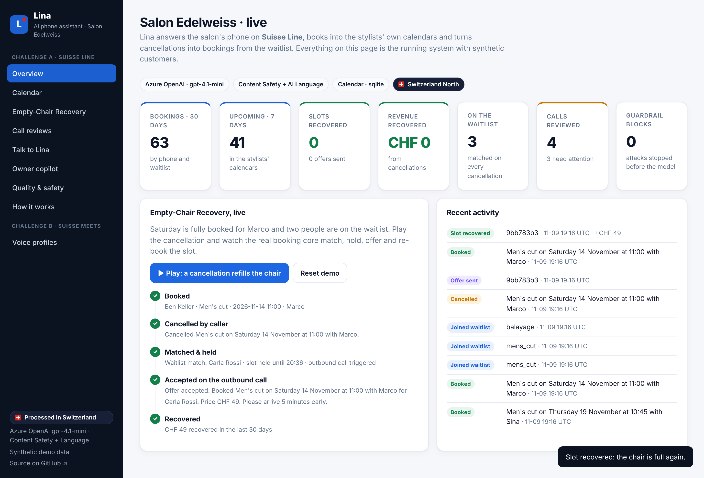
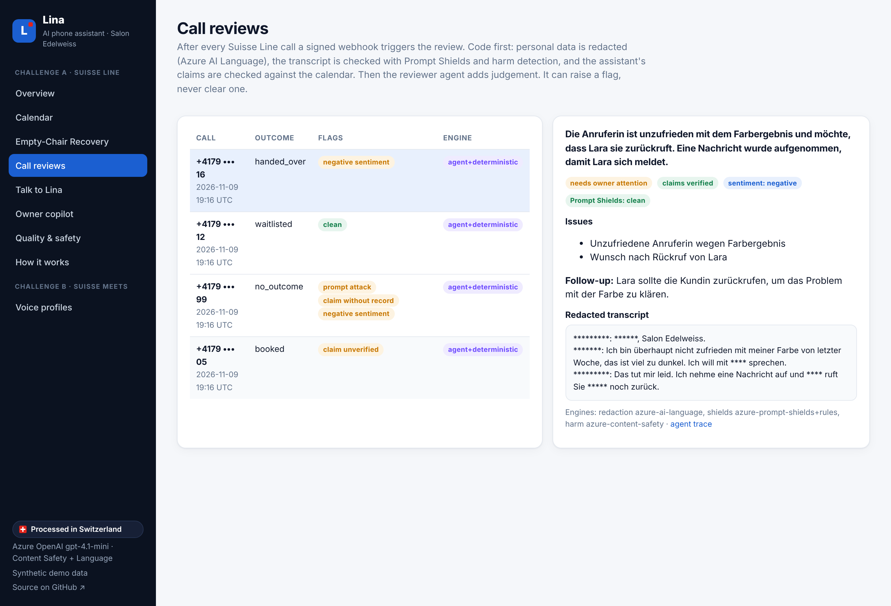

# Solution walkthrough

This walkthrough follows the system through three moments: a call that becomes a booking, a cancellation that refills the chair, and the review that follows every call. Every screen shown is the live web app on synthetic data: <https://ca-lina-yrrwxlzlnd7w2.wittyisland-bad0e48d.switzerlandnorth.azurecontainerapps.io>.

## 1. A call becomes a booking

> **Caller:** "Hetted Sie am Samschtig am Morge öppis für en Herrehaarschnitt?"

| Step | What happens | Where |
| --- | --- | --- |
| 1 | Suisse Line recognises Swiss German and Lina calls **`lookup_caller`**: today's date, whether the number belongs to a regular, any pending waitlist offer | Suisse Line → live tool |
| 2 | **`check_availability`** returns at most three free times, closest to the wish, for stylists who offer the service and work that day, with the cleanup buffer and lead time applied | booking core |
| 3 | Lina reads the options naturally; the caller chooses and confirms name and number | Suisse Line |
| 4 | **`book_appointment`** re-checks the slot under a lock and writes the event to the stylist's calendar, with the caller's number in hidden properties | booking core → calendar |
| 5 | Lina confirms day, time, stylist and price; Suisse Line sends the salon its e-mail summary | Suisse Line |

The same agent can be tried in text under **Talk to Lina**: same prompt, same knowledge base, same tools over MCP, booking into a sandbox calendar. The panel on the right shows every step the agent took: guardrails, tool calls with their arguments and results, and model calls.

The calendar view shows what Lina sees: each stylist's day, with staff blocks and held offers.

## 2. A cancellation refills the chair: Empty-Chair Recovery

Saturday is fully booked for Marco; Carla and Luca are on the waitlist. Ben cancels his 11:00.

| Step | What happens |
| --- | --- |
| 1 | `cancel_appointment` frees 11:00–11:30 in Marco's calendar |
| 2 | The freed time is matched against the waitlist: the service must fit the gap, Marco must offer it, and the date range and time of day must match. Carla matches first |
| 3 | The slot is **held for 20 minutes**, so no other caller is offered it, and a `waitlist.offer` webhook starts a Suisse Line **outbound call** to Carla |
| 4 | Carla accepts (`accept_offer`): the slot is booked. Had she declined or not answered, Luca would have been next. Nobody is offered the same slot twice |

On the overview, **Play: a cancellation refills the chair** replays exactly this on the real booking core, and the recovered revenue appears in the key figures.

## 3. Every call is reviewed

After each call Suisse Line sends a signed `call.completed` webhook. The review runs in the background:

1. **Redaction first.** Names, numbers, e-mails and IBANs are removed with Azure AI Language (plus deterministic rules) before anything is stored.
2. **Safety checks.** Prompt Shields and harm detection run on the transcript.
3. **Claim check.** If the transcript says "booked" and no booking was recorded, the call is flagged.
4. **Judgement.** The reviewer agent summarises the call for the owner, classifies the outcome, verifies claims with read-only tools and suggests follow-ups. It can add a flag; it cannot remove one raised by code.

## 4. The owner asks questions

The **owner copilot** answers questions such as "How much did Empty-Chair Recovery bring this month?" or "Who is waiting for Saturday?" through the read-only owner MCP server. There are no write tools on that server; changes happen in the calendar.

## 5. Where to look in the code

| Concern | File |
| --- | --- |
| Availability rules | [`app/slots.py`](../app/slots.py) |
| Booking, ownership checks, Empty-Chair Recovery | [`app/booking.py`](../app/booking.py) |
| Tool registry (live tools, MCP, `tools.json`) | [`app/tools.py`](../app/tools.py) |
| MCP servers | [`app/mcp_server.py`](../app/mcp_server.py) |
| Agents and guardrails | [`app/ai_agents/`](../app/ai_agents) |
| Azure AI tools | [`app/ai_tools.py`](../app/ai_tools.py) |
| Calendars | [`app/calendars/`](../app/calendars) |
| Suisse Line configuration | [`suisse-line/`](../suisse-line) |
| Infrastructure | [`infra/`](../infra) |
