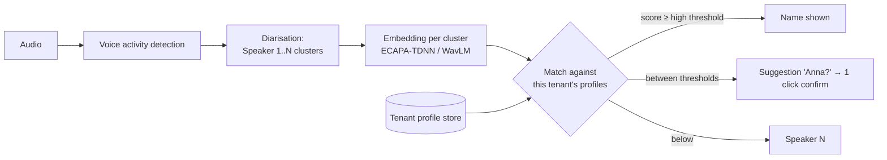

# Challenge B (bonus): Voice profiles for Suisse Meets

**Goal:** Suisse Meets learns the voices of a customer's team once and then names speakers automatically in every future meeting, on phone, recording device and browser. Biometric data is processed only with each person's explicit consent and can be deleted at any time.

**Non-goal:** voice is never used to *authenticate* anyone. It only labels transcripts. That keeps the risk lower and the error handling simple: when unsure, show "Speaker 2".

---

## 1. How a voice gets into the system, and how consent is given

**Legal frame** (to be validated with counsel): a voice profile that identifies a person is *besonders schützenswerte Personendaten* under the Swiss revDSG (Art. 5 lit. c Ziff. 4) and special-category data under GDPR (Art. 9). We rely on **explicit consent** (revDSG Art. 6 Abs. 7; GDPR Art. 9(2)(a)), which must be as easy to withdraw as to give (GDPR Art. 7(3)). The customer organisation is the controller; Suisse IT is the processor. Because employees depend on their employer, consent must be **genuinely voluntary**: declining has no consequence except that the person stays "Speaker N".

**Enrolment flow**
1. The org admin enables "Voice recognition" for the organisation. This only *allows* enrolment; it never enrols anyone.
2. Each person gets a **personal invitation**: by e-mail, or a prompt after someone renamed "Speaker 2" to them ("Should Suisse Meets recognise Anna automatically? → we ask Anna"). Only the person themselves can consent, never the admin or a colleague.
3. **Consent screen** in plain language (DE/FR/IT/EN): what is stored (a mathematical voice signature, not recordings), the only purpose (naming you in your organisation's transcripts), where (Switzerland), retention (until you delete it or leave, auto-delete after 12 months without use), who sees it (nobody, only a status). An unticked checkbox plus an "I agree" button; "No thanks" is equally prominent.
4. **Recording:** read three short sentences (about 30 s net speech) in the browser or app, optionally a second device. Live quality checks: enough speech, one speaker, no clipping, acceptable noise; otherwise "please repeat".
   *Alternative:* "use my voice from last Tuesday's meeting". The person confirms segments where they spoke, which gives more natural audio from the real device and channel.
5. The enrolment audio is converted to embeddings and the **raw audio is deleted** (kept at most 24 h for reprocessing).
6. A **consent record** is written to an append-only ledger: person, tenant, consent-text version and hash, timestamp, device/IP, method.

**Withdrawal and deletion**: "Delete my voice profile" in the profile settings and in every meeting e-mail footer. Deletion is immediate in the live system and cryptographically effective in backups (per-profile key destroyed, see §3). Admin offboarding of a leaving employee deletes their profile. Already-written transcripts keep the names that were assigned (that is transcript data, not biometrics), and the consent text says so. A new consent text version triggers re-consent.

**External participants** (clients, guests) are never enrolled. They appear as "Speaker N"; the meeting notice says that internal participants may be recognised.

## 2. How recognition works, and how we measure it



* **Diarisation first, identification second.** The existing pipeline already produces speaker clusters. For each cluster we average the embeddings of its clean segments (skipping overlap and segments under 2 s).
* **Small candidate set.** Compare only against profiles of the meeting owner's tenant, narrowed further to invited participants when the calendar invite is known. Choosing among 6 people is far more accurate than among 300.
* **Assignment, not independent guesses.** Cosine-similarity matrix clusters × profiles, then optimal one-to-one assignment (Hungarian algorithm), so two clusters never get the same name unless they are merged.
* **Two thresholds** calibrated **per device class** (phone, recorder, browser), because channel mismatch is the biggest error source. Profiles store one embedding per device class where available.
* **Learning from corrections:** when a user confirms or corrects a name, high-confidence segments can refresh the profile (covered by the consent text, with drift and poisoning guards: capped weight, only confirmed segments).
* Everything runs in the existing Swiss infrastructure. No third-party API sees voice data.

**Measuring "is it right"**

The worst error is a **wrong name**: it attributes words to the wrong colleague. A missed name ("Speaker 2") is only annoying. So thresholds are set for a very low false-accept rate.

| Metric | Definition | Launch target |
| --- | --- | --- |
| Wrong-name rate | clusters labelled with the wrong person / labelled clusters | ≤ 1 % |
| Coverage | enrolled speakers auto-named / enrolled speakers present | ≥ 85 % (meetings ≤ 8 people) |
| Attributed-word accuracy | words attributed to the correct named person | ≥ 95 % |
| DER | diarisation error rate (existing baseline, must not regress) | ≤ current |
| Correction rate (production) | auto-names renamed by users / auto-names | ≤ 2 %, alert at 3 % |

* **Offline benchmark** before any customer sees it: about 30 consenting internal speakers × 3 device classes × Swiss German, German, French, Italian and English × quiet and noisy rooms × 2–10 people, plus public sets (AMI meeting corpus, VoxCeleb) as a sanity baseline. DET curves per device class are used to choose the thresholds.
* **Online:** the correction rate, suggestion-acceptance rate and coverage, sliced by device, language and meeting size. These are the production truth signals and need no extra labelling.

## 3. Strict separation between customers

* **Tenant ID comes from the authenticated meeting owner, never from the request.** The matching service has no API that accepts a tenant parameter from a client.
* **Storage:** a separate vector collection per tenant, plus Postgres row-level security on all profile and consent tables. A query without a tenant context returns nothing.
* **Encryption:** envelope encryption with a per-tenant key in a Swiss KMS/HSM, and a **per-profile data key**. Deleting a profile destroys its key, which makes copies in backups unreadable (crypto-shredding) without restoring and editing backups.
* **No cross-tenant matching, ever.** A consultant working for two customers has two independent profiles with two consents.
* **No human access** to embeddings. Admin UIs show only status (enrolled, consent date, last used). Every match job is audit-logged (tenant, meeting, profiles compared, decision), and the logs are retained per policy.
* **No training on customer voices** (model weights are shared and trained on licensed and public data). Any future improvement program would need a separate opt-in.
* **Verified, not assumed:** CI isolation tests (a job for tenant A seeded with tenant B's profile must never match), RLS policy tests, deletion tests (profile, key and vector are gone; the backup restore test can't decrypt), plus an external penetration test before GA.

## How it plugs into Suisse Meets today

The public Suisse Meets API (v1) already delivers what recognition builds on. `POST /api/v1/transcribe` with `enhanced_speaker_diarization=true` returns `transcript.segments[]` with `speaker`, `start_ms`, `end_ms` and `confidence`, plus a `speakers[]` list. Voice profiles add **one step between diarisation and the transcript the user sees**:

```
audio ──► Suisse Meets: transcribe + diarise ──► segments (Speaker 1, Speaker 2 …, start/end ms)
                                                   │
          audio slices per speaker (≥ 2 s, no overlap) ──► embedding ──► match against the
                                                   │                       tenant's profiles
                                                   ▼
                         Speaker 1 → "Anna Meier" (0.82) · Speaker 2 → "Speaker 2" (no match)
```

* The prototype runs the voice-profile service **next to** the API: it sends test meetings with `zero_data_retention=true`, so Suisse Meets deletes audio, transcript and summaries right after handing them over. It verifies the `X-Suisse-Notes-Signature` webhook HMAC and deduplicates on `delivery.id`.
* In the product, the same step would run inside the Suisse Meets pipeline, before the transcript is stored, on any device (phone, recorder, browser), because diarisation is already device-independent.
* Recognised names are written to the existing `speaker` field, so the apps, summaries and documents need no change.

## 4. Build, test and launch, step by step

| Phase | Weeks | Deliverable | Exit criterion |
| --- | --- | --- | --- |
| 0 Legal and design | 1–2 | DPIA (revDSG Art. 22 / GDPR Art. 35), consent texts in 4 languages, DPA addendum, UX prototype of consent and enrolment tested with 5 users | counsel sign-off; users understand what they agree to |
| 1 Benchmark spike | 2–5 | evaluation set (§2), two embedding models compared, threshold calibration per device | wrong-name ≤ 1 % at coverage ≥ 85 % offline, else iterate |
| 2 MVP behind feature flag | 5–9 | enrolment (browser and app), consent ledger, tenant-isolated profile store with crypto-shredding, matching in post-processing for **browser** recordings, names / suggestions / one-click correction, delete flow | all isolation and deletion tests green |
| 3 Dogfooding → closed beta | 9–12 | Suisse IT's own meetings, then 3–5 friendly customers; add phone and recorder with their own calibration | production correction rate ≤ 2 %; no consent or deletion support issues |
| 4 GA | 13+ | org-level opt-in, privacy notice, support playbook (deletion immediately, export on request), monitoring and alerts on correction rate and drift | — |

**Main risks and mitigations**
* *Pressure on employees to consent* → personal invitation, equal "No thanks", no admin visibility of who declined (only who enrolled).
* *Similar voices, colds, short turns* → suggestion mode, minimum 2 s segments, profile refresh from confirmed segments.
* *Channel mismatch (phone vs laptop)* → per-device thresholds and embeddings; launch per device class only once it meets the targets.
* *Silent quality decay* → production correction-rate alert; monthly re-run of the offline benchmark.
